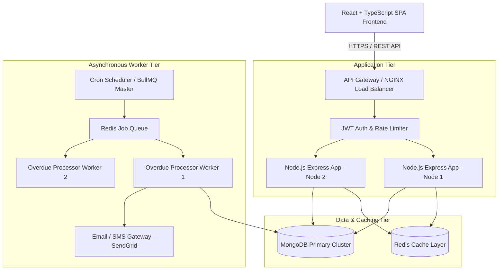
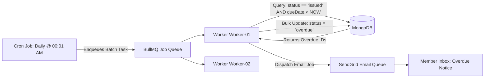

# 🏗️ Section C — System Design: ShelfLife Platform [10 Marks]

## 1. Executive Summary & System Overview

**ShelfLife** is designed as a highly scalable, fault-tolerant, multi-tier library management platform capable of serving hundreds of college campuses, thousands of active librarians, and millions of book borrowing records.

### High-Level Architecture Diagram



---

## 2. Database Design & Indexing Strategy

### Data Models & Normalization Balance
- **Book Entity:** Contains total inventory count (`totalCopies`) and real-time available inventory (`availableCopies`). Keeping `availableCopies` directly on the Book document provides **O(1)** availability checks during search and borrowing without executing costly aggregation pipelines over millions of historical borrow records.
- **Member Entity:** Stores user metadata, credentials hash, and unique indexed `membershipId` and `email`.
- **BorrowRecord Entity:** References `book` (ObjectId) and `member` (ObjectId), maintaining event timestamps (`issueDate`, `dueDate`, `returnDate`) and state flags (`issued`, `returned`, `overdue`).

### Indexing Strategy for High Throughput
To maintain sub-50ms query latency under heavy concurrency:

```typescript
// 1. Books Collection
bookSchema.index({ genre: 1, availableCopies: -1 }); // Fast genre filter & availability sorting
bookSchema.index({ title: 'text', author: 'text', ISBN: 'text' }); // Compound text search

// 2. Members Collection
memberSchema.index({ email: 1 }, { unique: true });
memberSchema.index({ membershipId: 1 }, { unique: true });

// 3. BorrowRecord Collection
borrowRecordSchema.index({ member: 1, status: 1, dueDate: 1 }); // O(1) Member History lookup
borrowRecordSchema.index({ status: 1, dueDate: 1 }); // Fast worker scan for overdue books
```

---

## 3. Concurrency & Race Condition Solutions (Distributed Scale)

### Scenario: Multiple librarians issuing the last physical copy simultaneously
When `availableCopies = 1`, simultaneous HTTP requests could result in negative inventory if unhandled.

```mermaid
sequenceDiagram
    autonumber
    participant Librarian A
    participant Librarian B
    participant Node.js API
    participant MongoDB Engine
    
    Librarian A->>Node.js API: POST /api/borrow (Book X)
    Librarian B->>Node.js API: POST /api/borrow (Book X)
    
    rect rgb(20, 30, 50)
    note over Node.js API, MongoDB Engine: Single-Document Atomic Update
    Node.js API->>MongoDB Engine: findOneAndUpdate({ _id: X, availableCopies: { $gt: 0 } }, { $inc: { availableCopies: -1 } })
    MongoDB Engine-->>Node.js API: Acquired Lock -> Decrements to 0 (Success)
    Node.js API->>MongoDB Engine: findOneAndUpdate({ _id: X, availableCopies: { $gt: 0 } }, { $inc: { availableCopies: -1 } })
    MongoDB Engine-->>Node.js API: Query Match Failed (0 copies left) -> Returns Null
    end
    
    Node.js API-->>Librarian A: 201 Created (Book Issued)
    Node.js API-->>Librarian B: 400 Bad Request ("No copies available")
```



### Multi-Replica Distributed Lock (Redis / Redlock)
In multi-region microservice deployments, distributed locks guarantee cross-datacenter isolation:
```typescript
const lockKey = `lock:book:${bookId}`;
const lockAcquired = await redis.set(lockKey, workerId, 'NX', 'PX', 3000); // 3-second lock TTL
if (!lockAcquired) {
  throw new AppError('Resource locked by concurrent operation. Please retry.', 429);
}
try {
  // Execute transaction
} finally {
  await redis.eval(releaseLockScript, 1, lockKey, workerId);
}
```

---

## 4. Asynchronous Overdue Processing Engine

### Architectural Challenge
Scanning millions of active borrow records on every user request to check for overdue items degrades REST API response times.

### Solution: Worker Queue Architecture (BullMQ + Redis + Cron)



### Scalability Guarantees:
1. **Chunked Bulk Updates:** Overdue records are processed in batches of 1,000 using MongoDB `bulkWrite()` to minimize memory pressure.
2. **Idempotency:** Email jobs carry idempotency keys (`overdue:borrowId:date`) preventing duplicate notifications if a worker retries.

---

## 5. Caching Strategy (Redis)

- **Cache-Aside Pattern for Book Catalog:**
  - Catalog searches (`GET /api/books?genre=Technology`) are cached in Redis with a 15-minute TTL (`TTL = 900s`).
  - When a librarian adds or modifies a book, a cache-invalidation event clears genre cache keys (`redis.del('books:genre:*')`).
- **Member Session Caching:**
  - Active JWT payload / librarian permissions cached in Redis to prevent database roundtrips on every authenticated API request.

---

## 6. Security, Monitoring & Reliability

1. **Rate Limiting:** IP-based and User-based rate limiting (`express-rate-limit`) restricting login attempts to 5 per minute and general API requests to 100 per minute.
2. **Role-Based Access Control (RBAC):** Middleware checks `req.user.role === 'librarian'` before granting write/issue permissions.
3. **Observability:** Structured JSON logging (`winston`) integrated with Prometheus metrics and Grafana dashboards tracking endpoint latencies and database pool saturation.
